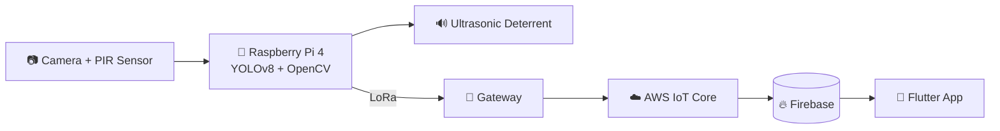

<div align="center">


<a href="https://github.com/Elamukil001">
  
</a>

<br/>


</div>

<br/>

## 👨‍💻 About Me

<table>
<tr>
<td width="62%" valign="top">

Hi 👋 I'm **R. Elamukil**, a final-year **Electronics and Communication Engineering** student who loves turning ideas into working products, from clean web interfaces to smart IoT devices.

- 🎓 Pursuing **B.E. in ECE** (2027)
- 💻 Into **Front-End Development, UI/UX Design & Cloud**
- 🔌 Exploring **Embedded Systems, IoT, RF & Edge AI**
- 🏆 **2× First Prize** winner (Hackathon + Ideathon)
- 📡 **RF for IoT** intern @ SASTRA
- 📶 **Telecom** intern @ BSNL, Thanjavur
- 🌱 Always learning, experimenting and building

</td>
<td width="38%" valign="middle" align="center">

```text
┌──────────────────────────┐
│  👩‍💻 const elamukil = {   │
│   role: "ECE Student",   │
│   focus: ["Web","IoT",   │
│           "Edge AI"],    │
│   awards: 3,             │
│   status: "Building 🚀"  │
│  };                      │
└──────────────────────────┘
```

</td>
</tr>
</table>

> 💡 *"Learn continuously. Build meaningfully. Contribute impactfully."*

---

## 🛠️ Tech Stack

<div align="center">


<br/>

<br/>


<br/><br/>


</div>

---

## 💼 Experience & Internships

| 🏢 Organization | 🎯 Role | 📝 What I explored |
|:---|:---|:---|
| **SASTRA** | 📡 RF for IoT Intern | Radio Frequency technologies, wireless communication concepts, and RF in IoT applications |
| **BSNL, Thanjavur** | 📶 Telecom Infrastructure Intern | Digital communication systems, optical fiber and FTTH network architecture |

---

## 🚀 Featured Projects

<table>
<tr>
<td width="50%" valign="top">

### 🏭 Smart Industry Light System
🏆 **First Prize, Naan Mudhalvan Hackathon**

Intelligent industrial lighting that improves energy efficiency through automated control.

`IoT` `Embedded Systems` `Sensors`

</td>
<td width="50%" valign="top">

### 🛡️ Women's Safety Device
🏆 **First Prize, Ideathon, Anjalai Ammal Mahalingam Engineering College**

A technology-driven device concept addressing real-world women's safety challenges.

`Embedded Systems` `IoT`
<!-- Update the tags above with your final design -->

</td>
</tr>
<tr>
<td width="50%" valign="top">

### ❤️ Wearable Smart Patient Monitor
ESP32-based wearable prototype for patient status monitoring and emergency alerts.

- MPU6500 motion sensor
- Temperature and humidity monitoring
- AD8232 ECG interface

`ESP32` `Embedded C` `MPU6500` `AD8232` `DHT` `IoT`

</td>
<td width="50%" valign="top">

### 🌱 Smart Agriculture Monitoring
IoT agriculture project exploring sensor data collection, LoRa communication, and antenna performance analysis.

`Raspberry Pi` `LoRa` `IoT` `HFSS` `Antenna Design`

</td>
</tr>
<tr>
<td colspan="2" valign="top">

### 🌐 Digital Welfare Website
A web project that presents digital welfare information and services through an accessible, easy-to-use interface.

`HTML` `CSS` `JavaScript`

</td>
</tr>
</table>

### 🐘 Spotlight: Vanakaaval, AI Wildlife Detection & Deterrence

An **Edge AI** system that helps reduce human–wildlife conflict by detecting animals and deterring them automatically.

- 👁️ Detects wildlife using computer vision and **YOLOv8**
- 🧠 Runs on **Raspberry Pi 4** with PIR sensing and an **ultrasonic deterrent**
- 📡 Uses **LoRa** for communication between system components
- ☁️ Integrates **Firebase**, a **Flutter** mobile app, and **AWS IoT Core**



`Python` `Raspberry Pi` `YOLOv8` `OpenCV` `LoRa` `Firebase` `Flutter` `AWS IoT Core`

---

## 🏆 Achievements & Awards

| 🏅 Event | 🎖️ Recognition |
|:---|:---|
| Naan Mudhalvan Hackathon | 🥇 **First Prize**, Smart Industry Light System |
| Ideathon, Anjalai Ammal Mahalingam Engineering College | 🥇 **First Prize**, Women's Safety Device Proposal |
| Kalai Kalloori Thiruvizha | 🥈 **Second Prize** |
| SASTRA | 📡 RF for IoT Internship |
| BSNL, Thanjavur | 📶 Telecom Infrastructure Internship |

---

## 🎓 Education

| 🎓 Qualification | 🏫 Institution | 📅 Year |
|:---|:---|:---:|
| B.E. Electronics and Communication Engineering | Government College of Engineering, Sengipatti, Thanjavur | 2027 |
| Higher Secondary Certificate (HSC) | Thirumagal Higher Secondary School, Thanjavur | 2023 |

---

## 🌱 Currently Learning

<div align="center">


</div>

---

## 📊 GitHub Stats

<div align="center">


<br/>


</div>

## 📈 Contribution Activity

<div align="center">


</div>

## 🏅 Trophy Wall

<div align="center">


</div>

---

## 📫 Connect With Me

<div align="center">

<a href="https://github.com/Elamukil001"></a>
<!-- Replace the URL below with your own LinkedIn profile link -->
<a href="https://www.linkedin.com/in/YOUR-LINKEDIN-ID"></a>
<!-- Optional: add your email
<a href="mailto:your-email@example.com"></a>
-->

<br/><br/>

**🤝 Open to:** collaborative projects · internships · learning opportunities · tech communities

<br/>

⭐ *Thanks for visiting my profile! Feel free to explore my repositories.*


</div>
